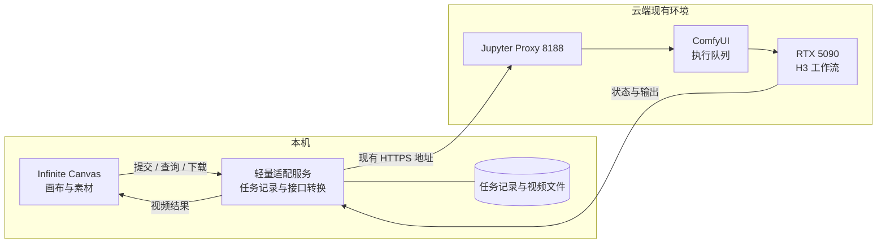

# AI 创意工作台：Infinite Canvas 接入云端 ComfyUI 的方案

可行。现有 Infinite Canvas 可以继续负责画布、素材、提示词和视频节点；云端 ComfyUI 负责实际生成。中间增加一个轻量适配服务，把画布的视频请求转换为 ComfyUI 工作流任务，就能接上已有的 RTX 5090 和 H3 模型。

第一版建议先把画布和适配服务放在本机，适配服务通过现有 Jupyter Proxy 调用云端 ComfyUI。当前本机已经能读取云端 API，这条路线适合先验证创作闭环。后续要让多台电脑使用，再把适配服务部署到云端，让它直接调用同一运行环境里的 ComfyUI。

本文是待实施方案。本次完成了仓库克隆、代码阅读和云端只读检查，没有安装项目依赖、改动业务代码或云端配置，也没有提交生成任务。

**1. 已经确认了什么**

| 项目 | 本次检查结果 | 能说明的范围 |
|---|---|---|
| 工作台仓库 | 已克隆 `qso/infinite-canvas` 到当前项目；版本 `v0.18.0`，提交 `d213a74614e0e4bd8a26383d1e1e907249e9c61b` | 以下代码判断针对这个提交 |
| 前端结构 | React、Vite、TypeScript；视频接口集中在 `web/src/services/api/video.ts` | 可以沿用现有视频节点和任务流程 |
| ComfyUI | `/system_stats` 返回版本 `0.34.0`，PyTorch `2.13.0+cu130` | 服务能够被当前本机网络访问 |
| GPU | API 与现有页面均显示一张 RTX 5090，32 GB 级显存 | 没有测量生成时的显存峰值和速度 |
| H3 模型 | 模型列表包含 FL2VA、Ref2VA 的 INT8 / pruned INT8 权重，以及 NVFP4 编码器、视频和音频 VAE | 确认文件名可被服务发现，未验证权重加载和实际推理 |
| 现有工作流 | 找到原生 R2V、I2V、Turbo 等保存文件 | 已检查部分保存版结构；不是生成验收 |
| 队列与历史 | `/queue` 返回空队列，所查询的 `/history` 返回空对象 | 无法从此次历史读取确认最近成功生成或耗时 |
| 浏览器跨域 | 携带 `Origin: http://localhost:3000` 的 GET 与 `/prompt` OPTIONS 均未返回跨域许可头 | 本地网页直接请求云端存在跨域障碍 |

上述 GET 请求未显式携带 Cookie 或 API Key，仍然返回 JSON。这只证明当前本机网络可读取这些端点，不证明任意公网客户端可访问，也没有验证 POST 上传、提交任务是否受其他鉴权或代理规则限制。

云端入口：[ComfyUI](https://tmax-guian-14009.tmax.netease.com/_dep457/develop/jupyter/dep457-daixinliang-generate-test/proxy/8188/)；[JupyterLab](https://tmax-guian-14009.tmax.netease.com/_dep457/develop/jupyter/dep457-daixinliang-generate-test/lab)。精简检查记录见 [只读证据](comfyui-readonly-evidence.json)。

**2. ComfyUI 已经有 API，要补的是接口转换**

在 ComfyUI 页面点击运行，本质上就是提交一张可执行的节点图。程序也可以提交这张图，再查询任务状态、取回生成文件。已有端点包括：

| 环节 | ComfyUI 接口 | 作用 |
|---|---|---|
| 上传参考图 | `POST /upload/image` | 返回云端实际保存的文件名 |
| 提交工作流 | `POST /prompt` | 校验图结构并入队，返回 `prompt_id` |
| 查看排队 | `GET /queue` | 区分排队中和执行中 |
| 读取结果 | `GET /history/{prompt_id}` | 获取执行状态、错误和输出文件信息 |
| 下载文件 | `GET /view?filename=...&subfolder=...&type=output` | 取回对应输出；具体媒体格式取决于输出节点 |
| 订阅过程 | `/ws?clientId=...` | 接收节点执行、采样进度等消息 |

本次实际读取了状态、模型、节点定义和工作流端点。上传、提交、下载生成视频及 WebSocket 均留待实施阶段验证。端点语义依据 [ComfyUI 自建服务 API 文档](https://docs.comfy.org/development/comfyui-server/comms_routes)。

工作台目前会发送 `POST /v1/videos`，然后查询 `/v1/videos/{id}`。ComfyUI 接收的是工作流 JSON，两边请求结构不同。项目还会自动补上 `/v1` 路径，因此不能直接把现有 ComfyUI 地址当成兼容的视频服务。

**3. 推荐的调用过程**

用户在画布上连接参考图和提示词，选择“云端 H3 参考生成”，点击生成。适配服务上传素材，把提示词、素材文件名、时长和尺寸填进固定工作流，提交给 ComfyUI，并立即返回工作台任务编号。画布随后查询状态；完成后下载视频，显示在视频节点中。

适配服务可以用 FastAPI 加 SQLite 实现，独立环境运行，不引入 Torch，也不修改 ComfyUI 的 Python 环境。GPU 调度先沿用 ComfyUI 现有队列；SQLite 记录工作台任务与 ComfyUI `prompt_id` 的关系、工作流版本、实际参数、错误和输出文件。无需一开始增加 Redis 或独立任务集群。

本地开发时，可由 Vite 转发同源 `/api` 请求给适配服务，使浏览器不直接跨域访问 ComfyUI。服务只监听本机，另设工作台服务密钥，与仓库现有 Bearer Key 调用方式对接。它只提供确定的视频功能，不做任意 URL 的通用转发代理。

| 部署方式 | 适用阶段 | 需要处理的事情 |
|---|---|---|
| 本机画布＋本机适配服务，调用现有云端 8188 代理 | 推荐的第一版 | 本机需要保持可访问公司网络；新进程常驻才能持续归档结果 |
| 本机画布＋云端适配服务 | 需要独立云端 API 时 | 适配服务通过一个待选端口接入 Jupyter Proxy，直连 `127.0.0.1:8188`；核对鉴权、允许来源、上传和媒体响应 |
| 画布与适配服务一同部署云端 | 多设备长期使用时 | 还需适配前端 `/proxy/端口/` 下的资源路径、路由和页面刷新；项目目前并非只改一个部署路径就能保证运行 |

Jupyter Proxy 文档确认它支持代理 HTTP 和 WebSocket，并通常移除 `/proxy/端口` 前缀。新端口能否在当前平台工作仍需实际验证，见 [官方代理说明](https://jupyter-server-proxy.readthedocs.io/en/latest/arbitrary-ports-hosts.html)。

**4. 第一版采用哪张工作流**

优先使用保存版 `workflows/video_minimax_h3_r2v.json`。它有 29 个节点，执行节点在当前服务中能够找到定义，四个主要模型路径也与模型列表一致：

- 扩散模型：`minimax_h3_ref2va_pruned_int8_convrot.safetensors`。
- 编码器：`qwen3vl_32b_minimax_h3_nvfp4_awq.safetensors`。
- 视频 VAE：`minimax_h3_video_vae_fp16.safetensors`。
- 音频 VAE：`minimax_h3_audio_vae_fp32.safetensors`。

保存版为 16:9、0.4 MP 预览档、5 秒设置、24 fps；Turbo 总开关关闭，调度器实际连接普通 20 步分支。秒数通过现有表达式转换到有效帧数网格，例如 5 秒对应 124 帧，实际片长约 5.17 秒。这些是保存的参数，不是本次实测输出。

当前浏览器的同名标签带有未保存标记，页面中的修改可能与服务器保存文件不同。实施时应从选定版本导出独立的 API 模板，不覆盖用户正在编辑的工作流。

| 画布输入 | 保存版中的相关节点 | 适配方式 |
|---|---|---|
| 提示词 | `138` → `136.prompt` | 修改上游文本值，保留连接 |
| 参考图 | `137`、`139` → `136.ref_images.*` | 使用上传接口返回的实际文件名；少于两张时移除未使用引用，不能继续读取模板示例图 |
| 尺寸和比例 | `115` → `136.width/height` | 沿用分辨率计算规则，保证尺寸网格合法 |
| 时长 | `132` → `131` → `136.length` | 沿用秒数到帧数的换算，记录实际长度 |
| 随机种子 | `129.noise_seed` | 在任务记录中保存实际使用值 |
| 普通 / Turbo | `146` 控制 `141`、`142` | 模型 LoRA 与步数联动，固定经过验证的一套采样设置 |
| 输出 | `130` → `92` | 音视频合并后保存，再从该输出节点的历史结果定位文件 |

节点编号来自保存版编辑图，导出 API 格式后需要重新核对。动态输入、开关和旁路节点由 ComfyUI 自己导出，避免自行按编辑图的 `widgets_values` 顺序拼可执行请求。两种 JSON 格式的差别见 [工作流 API 格式文档](https://docs.comfy.org/development/api-development/workflow-api-format)。

首版先支持参考图和提示词，画布明确选择“通用参考”模式。R2V 不能悄悄把参考图当作首帧或尾帧；“首尾帧生成”应另建 FL2VA 模板和模型选项。当前保存图没有接参考视频、参考音频输入，虽然节点支持这些能力，仍需补上传、解码和连接之后才能开放。

`minimax_h3_turbo.json` 有 160 个节点，其中 81 个处于旁路模式；另有社区 I2V 文件使用了与当前模型列表不一致的模型路径。部分图中类型不出现在 `/object_info` 中，也可能是导出时消除的前端虚拟节点，不能仅凭这一点断言不可运行。这些图适合第二阶段逐张整理，不作为第一版的通用执行模板。

**5. 对画布提供什么接口**

以下是拟实现的接口，不是当前已经存在的服务：

| 接口 | 约定 | 与现有画布的衔接 |
|---|---|---|
| `GET /v1/models` | 返回允许调用的固定工作流列表 | 初始模型名可用 `comfy-h3-video-ref`，包含 `video` 便于现有模型类型识别 |
| `POST /v1/videos` | 接收现有 multipart 字段，返回 `id` 和 `status: queued` | 沿用当前提交逻辑，成功入队后尽快返回 |
| `GET /v1/videos/{id}` | 返回 `queued`、`in_progress`、`completed` 或 `failed`；失败携带 `error.message` | 复用当前任务轮询 |
| `GET /v1/videos/{id}/content` | 返回实际视频字节及正确的媒体类型 | 复用当前带鉴权的下载与本地素材保存逻辑 |

首版请求使用 `model`、`prompt`、`mode=reference`、`image[]`、`seconds` 和 `size`。画布还会发送 `resolution_name`、`generate_audio`、`watermark` 等字段；适配服务必须明确支持或拒绝不适用的选项，不能无声忽略会影响结果的参数。`size` 与分辨率描述冲突时应返回可读错误。参考视频、音频在模板接好以前不作为已支持输入。

完成状态先只返回 `status: completed`，让画布访问 `/content` 下载。当前代码若先收到 `video_url`，会走一个不自动附带生成服务鉴权头的 URL 下载分支；因此不应把需要鉴权的云端文件裸地址直接当作结果 URL。

服务按已审核的模板改参数，不接受浏览器提交任意节点图。每个任务持久化输入摘要、实际参数、模板版本、`prompt_id` 和输出定位；完成后把视频复制到选定的持久目录，再通知画布完成。原 ComfyUI 输出仍归云端管理，浏览器中的项目和素材仍按仓库现状保存在本地；这次接入本身不会增加项目云同步。

**6. 需要一起解决的运行体验**

自定义调用脚本适合快速连通验证，但当前实现把提交、等待、下载放在一次调用里，结果保存在内存 Map，画布也不保存这类任务的服务端编号。刷新或关闭页面会失去任务关联。正式入口建议使用上面的异步接口。

当前代码有约 5 分钟的轮询等待预算，另加请求耗时：公共视频等待函数、独立视频页面，以及脚本轮询默认值都涉及这一问题。单卡视频生成还可能排队，等待时间结束不代表 GPU 任务失败。建议保留任务编号，把网络断开和停止等待显示为可恢复状态；只有 ComfyUI 明确报错时才标记生成失败。画布页和独立视频页需要一起处理。

建议第一版 GPU 同时执行一项生成，由 ComfyUI 串行处理后续请求。实际超时、排队上限、上传大小限制和重试策略，在首次生成测量后确定；这里是方案建议，没有修改任何默认值。提交响应丢失时先核对服务端任务，不直接重提，避免重复生成。界面停止等待与取消云端任务也要区分；取消只能操作已核对归属的任务，不能清空用户手工排队的工作流。

历史记录当前为空，不能依赖它永久保存任务。若 ComfyUI 重启后既没有队列项也没有历史项，适配服务应把未决任务标为需要核对，不能据此宣称成功或自动重新生成。

API 接通也不等于复刻托管 H3 的所有效果。MiniMax 官方将完整链路分为 Context-IR、H3-Base 和 Regenerate-2K；官方仓库仍把本地 H3-Base 的验证路线与完整 2K 路线分开说明。第一版应以现有工作流的预览档和验证后的 768P 档为目标；若以后加入本地超分，明确标注处理方式，不能把它称作官方 2K 重生成。依据：[MiniMax 官方 H3 仓库](https://github.com/MiniMax-AI/MiniMax-H3)、[ComfyUI 原生 H3 指南](https://docs.comfy.org/tutorials/video/minimax/minimax-h3)。

**7. 建议实施顺序与验收**

1. 固定一份 R2V API 模板，核对素材输入、输出节点、模型路径和采样分支；先与用户页面中未保存版本做区分。
2. 经现有代理上传一张测试参考图，提交一个沿用保存参数的短视频任务，记录 `prompt_id`、等待时间、生成耗时、显存峰值和输出媒体信息。这一步才是首次实际执行。
3. 建立适配服务，接通模型列表、提交、查询和下载四个接口，使用本机独立环境与持久化任务记录。
4. 接入画布。验收参考图传递正确、视频返回原节点、生成中刷新仍可恢复、等待中断不会重复生成、真实失败有可读原因。
5. 再增加首尾帧模板、Turbo 预设和参考视频 / 音频；需要持续云端运行或多设备使用时，再安排云端适配服务部署。

首轮通过的标准是“从画布提交一组素材，云端执行一次，视频回到对应节点并能保存、播放，刷新后仍能关联任务”。接口返回成功、节点都已安装或模型文件存在，都不能替代这一轮验收。

**代码定位**

- [视频接口与结果处理](../../web/src/services/api/video.ts)：`createVideoGenerationTask`、`createOpenAIVideoTask`、`pollOpenAIVideoTask`、`createPluginVideoTask`。
- [画布任务保存与恢复](../../web/src/pages/canvas/project.tsx)：`completeVideoNodeTask`、`pollVideoNodeTask`。
- [独立视频页轮询](../../web/src/pages/video/index.tsx)：`pollGenerationLog`。
- [服务地址与渠道配置](../../web/src/stores/use-config-store.ts)：`buildApiUrl`、`resolveModelRequestConfig`、模型类型识别。
- [脚本调用机制](../../web/src/services/api/model-plugin.ts)：默认轮询时限、脚本请求变量。
- [素材本地持久化](../../web/src/services/file-storage.ts)：视频 Blob 写入浏览器存储。
- [前端路径](../../web/vite.config.ts)与[路由](../../web/src/router.tsx)：未来部署到 Jupyter 子路径时需要检查。

已检查现有 TODO 与 Pending Tests。本次没有实现功能，也没有把待讨论方案登记为已完成或待验收功能，因此不修改发布记录和现有测试清单。
